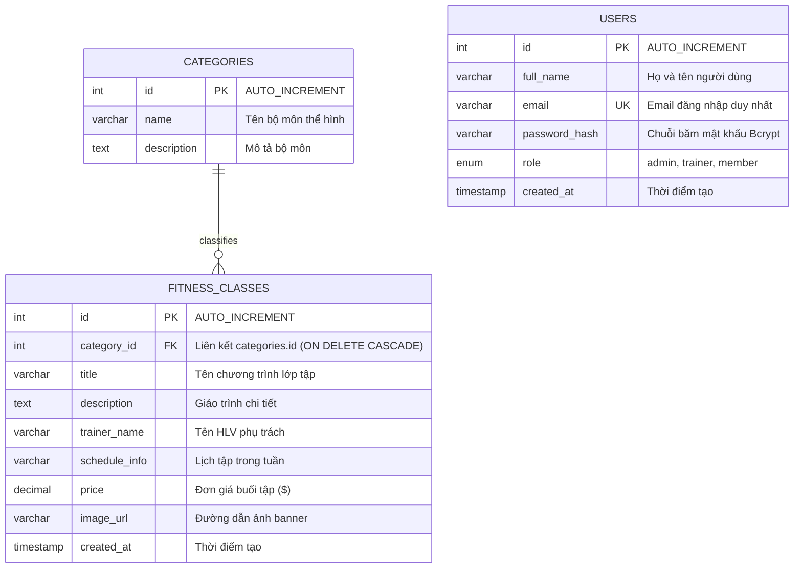

# BÁO CÁO TỔNG KẾT BÀI TẬP THỰC HÀNH LAB 2
## MÔN HỌC: LẬP TRÌNH WEB (WEB PROGRAMMING)
### COMPREHENSIVE LAB 2 FINAL REPORT & DELIVERABLES SPECIFICATION

---

## THÔNG TIN CHUNG (PROJECT GENERAL INFORMATION)

- **Chủ đề cá nhân (Personal Assignment Topic):** **T1 — Gym & Fitness Center Website**
- **Tên dự án:** Apex Fitness & Performance Center
- **Sinh viên thực hiện:** Thái Khang
- **Mã số sinh viên (Student ID):** 2452475
- **Lớp / Khóa:** CC01 - K2024
- **Thư mục làm việc:** `C:\xampp\htdocs\LAB1.3_CC01_2452475`
- **Thư mục ứng dụng web:** `C:\xampp\htdocs\LAB1.3_CC01_2452475\bookstore`
- **GitHub Repository:** [https://github.com/thkhang06/gym-fitness-web-lab-2452475](https://github.com/thkhang06/gym-fitness-web-lab-2452475)
- **Môi trường phát triển:** XAMPP for Windows (Apache 2.4.58, PHP 8.2.12, MariaDB/MySQL 10.4.32)

---

## 1. PROJECT TOPIC & ARCHITECTURAL OVERVIEW
*(Tổng quan đề tài & Kiến trúc ứng dụng)*

### 1.1. Giới thiệu đề tài (Topic Introduction)
Dự án **Apex Fitness & Performance Center** (Chủ đề T1) là nền tảng quản lý và giới thiệu trung tâm thể hình thể thao hiệu năng cao. Hệ thống kết nối giữa hội viên và đội ngũ huấn luyện viên chuyên nghiệp thông qua việc tra cứu lịch học, đăng ký tham gia các khóa huấn luyện (Powerlifting, HIIT, Thể dục dụng cụ, Boxing, Yoga phục hồi) và quản lý tiến trình tập luyện.

### 1.2. Cấu trúc thư mục chuẩn hóa (Project Structure)
Dự án được cấu trúc phân tầng rõ ràng theo chuẩn ứng dụng web PHP hiện đại:

```
LAB1.3_CC01_2452475/
├── index.php                       # Entrypoint điều hướng gốc chuyển tiếp về bookstore/public/
├── gym_fitness_db.sql               # Bản xuất CSDL hoàn chỉnh cho phpMyAdmin (Deliverable 2)
├── LAB2_FINAL_REPORT.md            # Báo cáo tổng kết chính thức nộp bài Lab 2 (Deliverable 4)
├── .gitignore                      # Cấu hình bỏ qua tệp nhị phân, cache và cấu hình IDE
└── bookstore/                      # Mã nguồn hoàn chỉnh ứng dụng web
    ├── DESIGN.md                   # Hệ thống Design Tokens tổng hợp từ Google Stitch MCP
    ├── auth/                       # Phân hệ Xác thực người dùng (Task 4)
    │   ├── login.php               # Đăng nhập & thiết lập Session
    │   ├── logout.php              # Đăng xuất, hủy Session và Cookie
    │   └── register.php            # Đăng ký tài khoản hội viên mới với mã hóa Bcrypt
    ├── components/                 # Các thành phần giao diện tái sử dụng
    │   ├── header.php              # Thanh điều hướng, bộ chọn Theme, trạng thái Auth & nút CRUD
    │   └── footer.php              # Chân trang và thông tin bản quyền
    ├── config/                     # Cấu hình lõi & các hàm tiện ích
    │   ├── database.php            # Kết nối CSDL MySQL qua PDO với UTF-8 và ngoại lệ PDOException
    │   ├── preferences.php         # Quản lý Cookie lưu tùy chọn giao diện & lịch sử (Task 5.2)
    │   └── session.php             # Quản lý Session, Flash Message và Phân quyền RBAC (Task 5.1 & 6)
    ├── database/                   # CSDL & kịch bản mẫu
    │   ├── gym_fitness_db.sql      # Kịch bản DDL/DML tạo bảng và chèn dữ liệu mẫu
    │   └── schema.sql              # Bản sao lưu cấu trúc CSDL
    ├── pages/                      # Phân hệ quản lý nghiệp vụ & trang nội dung
    │   ├── class_form.php          # Form Thêm mới / Cập nhật lớp tập có bảo vệ RBAC (Task 3 & 6)
    │   ├── classes.php             # Danh mục lớp tập, tìm kiếm từ khóa, lọc theo danh mục (Task 3)
    │   ├── clear_cookies.php       # Điểm cuối xử lý xóa Cookie và đặt lại tùy chọn (Task 5.2)
    │   ├── dashboard.php           # Bảng điều khiển phân quyền, Bảng kiểm định Session & Cookie
    │   ├── delete_class.php        # Xử lý xóa lớp tập bằng POST an toàn và Prepared Statement (Task 3)
    │   ├── item_details.php        # Trang chi tiết lớp tập động qua truy vấn PDO (Task 2)
    │   └── set_theme.php           # Điểm cuối chuyển đổi giao diện Sáng / Tối lưu vào Cookie (Task 5.2)
    └── public/                     # Thư mục tài nguyên công khai (Web Root)
        ├── css/
        │   └── style.css           # Bảng mã CSS tùy biến, Dark Gym Mode & hiệu ứng vi chuyển động
        ├── images/                 # Bộ ảnh mẫu chất lượng cao cho các lớp tập (item1.jpg -> item6.jpg)
        └── index.php               # Trang chủ động hiển thị danh mục và banner chào mừng tùy biến
```

### 1.3. Hệ thống Thiết kế Giao diện Đỉnh cao (Google Stitch MCP Design System - Phase 6)
Nhằm nâng tầm trải nghiệm thị giác lên tiêu chuẩn các câu lạc bộ thể thao hàng đầu thế giới (Equinox, Nike Training Club, Gymshark), dự án đã tích hợp và vận dụng **Google Stitch MCP** cùng bộ kỹ năng `stitch-skills` (`enhance-prompt`, `design-md`, `taste-design`):
- **Stitch Project ID:** `6697286312568266889`
- **Stitch Screen ID:** `a3307e60ed3c44aebd698ef7d9b6dc21`
- **Hệ thống Design Tokens ([`bookstore/DESIGN.md`](file:///C:/xampp/htdocs/LAB1.3_CC01_2452475/bookstore/DESIGN.md)):**
  - **Bảng màu chủ đạo:** Nền Obsidian `#090D16`, bề mặt kính mờ Midnight Charcoal `#111827` (`backdrop-filter: blur(14px)`), viền tinh tế `rgba(255, 255, 255, 0.08)`, sắc đỏ năng lượng **Electric Crimson `#F43F5E`** kết hợp **Volt Orange `#FF5500`** và huy hiệu xanh **Emerald `#10B981`**.
  - **Typography:** Bộ đôi thể thao mạnh mẽ `Space Grotesk` (tiêu đề, chỉ số kỹ thuật) và `Plus Jakarta Sans` (nội dung chi tiết).
  - **Bố cục Bento Grid:** Áp dụng trên Bảng điều khiển (`dashboard.php`) phân tách module thông tin mạch lạc, hiện đại.
  - **Tương thích toàn diện với Cookie `apex_theme`:** Duy trì chuyển đổi 2 chế độ Sáng / Tối mượt mà không bị chớp trắng.

---

## 2. DATABASE OVERVIEW (TỔNG QUAN CƠ SỞ DỮ LIỆU)

### 2.1. Thiết kế Lược đồ CSDL (Entity-Relationship Diagram & Design)
Cơ sở dữ liệu mang tên **`gym_fitness_db`** được chuẩn hóa thành 3 bảng với quan hệ khóa ngoại bảo đảm toàn vẹn dữ liệu:



### 2.2. Chi tiết cấu trúc các bảng (Database Schema Details)

#### 1. Bảng `categories` (Bảng phân loại bộ môn)
- **Mục đích:** Lưu trữ các phân nhánh rèn luyện chính trong phòng gym.
- **Khóa chính (PK):** `id` (`INT AUTO_INCREMENT`).
- **Các cột:** `name` (`VARCHAR(100)` NOT NULL), `description` (`TEXT` NULL).
- **Dữ liệu mẫu:** 4 bộ môn cốt lõi gồm:
  1. *Strength & Hypertrophy* (Tập tạ tăng cơ)
  2. *Cardio & Conditioning* (HIIT & Sức bền tim mạch)
  3. *Mobility & Core* (Dẻo dai & Cơ lõi)
  4. *Combat & Martial Arts* (Boxing & Kháng lực chiến thuật)

#### 2. Bảng `users` (Bảng tài khoản & Phân quyền)
- **Mục đích:** Lưu trữ định danh người dùng, thông tin xác thực và phân quyền RBAC.
- **Khóa chính (PK):** `id` (`INT AUTO_INCREMENT`).
- **Ràng buộc duy nhất (UK):** `email` (`VARCHAR(150)` NOT NULL UNIQUE).
- **Mật khẩu an toàn:** `password_hash` (`VARCHAR(255)` NOT NULL) được mã hóa bằng thuật toán `PASSWORD_BCRYPT`.
- **Vai trò:** `role` (`ENUM('admin', 'trainer', 'member')` NOT NULL DEFAULT `'member'`).
- **Tài khoản mặc định sẵn có:** (Mật khẩu chung: `Password123!`)
  - **Admin:** `admin@gymfitness.local` (Marcus Vance - Quyền quản trị toàn diện)
  - **Trainer:** `trainer@gymfitness.local` (Elena Rostova - Quyền quản lý lớp tập)
  - **Member:** `member@gymfitness.local` (Alex Nguyen - Quyền hội viên xem lịch tập)

#### 3. Bảng `fitness_classes` (Bảng thực thể nghiệp vụ chính)
- **Mục đích:** Quản lý danh sách các khóa huấn luyện và lớp tập tại trung tâm.
- **Khóa chính (PK):** `id` (`INT AUTO_INCREMENT`).
- **Khóa ngoại (FK):** `category_id` liên kết đến `categories.id` với hành vi `ON DELETE CASCADE ON UPDATE CASCADE`.
- **Các cột nghiệp vụ:**
  - `title` (`VARCHAR(150)` NOT NULL)
  - `description` (`TEXT` NOT NULL)
  - `trainer_name` (`VARCHAR(100)` NOT NULL)
  - `schedule_info` (`VARCHAR(100)` NOT NULL)
  - `price` (`DECIMAL(10,2)` NOT NULL DEFAULT 0.00)
  - `image_url` (`VARCHAR(255)` NULL)
  - `created_at` (`TIMESTAMP DEFAULT CURRENT_TIMESTAMP`)
- **Dữ liệu mẫu:** 6 lớp tập chuẩn mực sẵn có gắn liền với 6 ảnh đại diện chất lượng cao tại `public/images/item1.jpg` đến `item6.jpg`.

---

## 3. IMPLEMENTED FEATURES SUMMARY (TỔNG KẾT TÍNH NĂNG TỪ TASK 1 ĐẾN TASK 6)

| Task | Tên tính năng | Tệp triển khai chính | Mô tả chi tiết & Điểm kỹ thuật nổi bật |
| :--- | :--- | :--- | :--- |
| **Task 1** | Cài đặt CSDL MySQL | `bookstore/database/gym_fitness_db.sql` | Tạo CSDL `gym_fitness_db`, 3 bảng có đầy đủ PK, FK, mã hóa UTF-8 mb4 và chèn dữ liệu khởi tạo. |
| **Task 2** | Kết nối PDO & Hiển thị động | `bookstore/config/database.php`<br>`bookstore/public/index.php`<br>`bookstore/pages/item_details.php` | Kết nối PDO cấu hình `PDO::ATTR_ERRMODE => ERRMODE_EXCEPTION`, `ATTR_DEFAULT_FETCH_MODE => FETCH_ASSOC`. Dữ liệu hiển thị động qua Prepared Statements, chống XSS bằng `htmlspecialchars()`. |
| **Task 3** | Thao tác CRUD Lớp tập | `bookstore/pages/classes.php`<br>`bookstore/pages/class_form.php`<br>`bookstore/pages/delete_class.php` | **Read:** Tra cứu từ khóa, lọc theo bộ môn.<br>**Create & Update:** Form hợp nhất với validation chặt chẽ phía máy chủ, sticky form, xem trước ảnh banner.<br>**Delete:** Xóa an toàn bằng phương thức POST và Prepared Statement. |
| **Task 4** | Đăng ký & Đăng nhập | `bookstore/auth/register.php`<br>`bookstore/auth/login.php`<br>`bookstore/auth/logout.php` | Đăng ký tài khoản hội viên với mã hóa `password_hash($pwd, PASSWORD_BCRYPT)`. Đăng nhập đối chiếu qua `password_verify()`. Tái sinh ID phiên làm việc `session_regenerate_id(true)` để chống Session Fixation. |
| **Task 5.1**| Quản lý PHP Session | `bookstore/config/session.php`<br>`bookstore/pages/dashboard.php` | Quản lý phiên tập trung qua `session_start()`. Các hàm helper: `isLoggedIn()`, `getCurrentUser()`, `setFlash()`, `getFlash()`, `requireLogin()`. Gửi header `Cache-Control: no-store` để chống Back-button cache sau khi đăng xuất. |
| **Task 5.2**| Client-side Cookies | `bookstore/config/preferences.php`<br>`bookstore/pages/set_theme.php`<br>`bookstore/pages/clear_cookies.php` | Lưu tùy chọn giao diện (`apex_theme` - 30 ngày) và lịch sử truy cập (`apex_recent_class`, `apex_fav_category` - 7 ngày). Tuyệt đối không lưu dữ liệu nhạy cảm. Có chức năng Reset Preferences xóa Cookie. |
| **Task 6** | Phân quyền Server-side RBAC | `bookstore/config/session.php`<br>`bookstore/pages/class_form.php`<br>`bookstore/pages/delete_class.php` | Phân quyền nghiêm ngặt qua `hasRole()` và `requireRole(['admin', 'trainer'])`. Nếu vi phạm, trả về **HTTP 403 Forbidden** và trang thông báo chặn truy cập đẹp mắt, bảo vệ tuyệt đối dữ liệu. |

---

## 4. EXPLANATION OF SESSION AND COOKIE USAGE (GIẢI THÍCH CHI TIẾT CƠ CHẾ SESSION & COOKIE)

### 4.1. Cơ chế PHP Session (Task 5.1)
- **Nguyên lý hoạt động:** Phiên làm việc (Session) duy trì trạng thái đăng nhập phía máy chủ (Server-side). Client chỉ giữ một định danh duy nhất trong cookie gọi là `PHPSESSID`. Khi trình duyệt gửi yêu cầu, PHP tự động liên kết `PHPSESSID` với mảng `$_SESSION` tương ứng trên máy chủ.
- **Biến phiên được lưu trữ trong `$_SESSION`:**
  - `$_SESSION['user_id']`: Khóa chính định danh tài khoản người dùng (`users.id`).
  - `$_SESSION['full_name']`: Họ tên hiển thị trên giao diện chào mừng.
  - `$_SESSION['email']`: Địa chỉ email đăng nhập.
  - `$_SESSION['role']`: Vai trò người dùng (`'admin'`, `'trainer'`, `'member'`).
  - `$_SESSION['flash']`: Bộ nhớ đệm thông báo tạm thời (Success/Error Message), tự động xóa sau khi hiển thị.
- **Biện pháp bảo mật phiên cao cấp:**
  1. **Chống Session Fixation:** Sử dụng `session_regenerate_id(true)` ngay khi người dùng đăng nhập thành công để cấp phát một Session ID hoàn toàn mới, đồng thời hủy bỏ Session ID cũ.
  2. **Chặn trình duyệt hoàn toàn sau khi Logout:** Tại trang `logout.php`, hệ thống thực thi `$_SESSION = []`, xóa cookie phiên `setcookie(session_name(), '', time() - 42000, ...)` và gọi `session_destroy()`. Đồng thời các trang bảo mật (`dashboard.php`, `class_form.php`) đều gửi tiêu đề HTTP `Cache-Control: no-store, no-cache, must-revalidate` nhằm ngăn việc nhấn nút "Back" trên trình duyệt hiển thị lại dữ liệu mật.

### 4.2. Cơ chế Persistent Client Cookies (Task 5.2)
Tất cả Cookie của hệ thống được quản lý tập trung trong file [`bookstore/config/preferences.php`](file:///C:/xampp/htdocs/LAB1.3_CC01_2452475/bookstore/config/preferences.php) thông qua hàm `setcookie()` chuẩn của PHP:

| Tên Cookie | Giá trị lưu trữ | Mục đích sử dụng | Thời gian sống (Lifespan) | Cờ bảo mật (Flags) |
| :--- | :--- | :--- | :--- | :--- |
| **`apex_theme`** | `'light'` hoặc `'dark'` | Ghi nhớ chế độ hiển thị Sáng / Tối (Dark Gym Mode) theo sở thích người dùng. | **30 Ngày**<br>`time() + 86400 * 30` | `path: '/'`, `httponly: true` |
| **`apex_recent_class`** | Mã ID lớp tập (e.g. `1`) | Ghi nhớ lớp tập mà người dùng vừa xem chi tiết trên `item_details.php`. | **7 Ngày**<br>`time() + 86400 * 7` | `path: '/'`, `httponly: true` |
| **`apex_recent_title`** | Tên lớp tập (e.g. `Power Barbell Mastery`) | Hiển thị tiêu đề lớp tập vừa xem trên banner chào mừng tại `index.php` và `dashboard.php`. | **7 Ngày**<br>`time() + 86400 * 7` | `path: '/'`, `httponly: true` |
| **`apex_fav_category`** | Mã ID danh mục (e.g. `2`) | Ghi nhớ bộ môn tập luyện mà người dùng thường xuyên lọc tại `classes.php`. | **7 Ngày**<br>`time() + 86400 * 7` | `path: '/'`, `httponly: true` |
| **`apex_fav_category_name`** | Tên bộ môn (e.g. `Cardio & Conditioning`) | Hiển thị tên bộ môn ưa thích để gợi ý quay lại danh mục tương ứng. | **7 Ngày**<br>`time() + 86400 * 7` | `path: '/'`, `httponly: true` |

### 4.3. Tuân thủ tuyệt đối quy định an toàn Cookie (Security Compliance)
- **Không lưu dữ liệu nhạy cảm:** Hệ thống **tuyệt đối không lưu trữ mật khẩu (dù thô hay mã hóa), token xác thực hay quyền hạn tài khoản** vào Cookie phía máy khách. Tất cả thông tin nhạy cảm được cô lập hoàn toàn trong PHP Session trên máy chủ.
- **Cờ `HttpOnly`:** Tất cả các Cookie được thiết lập với cờ `HttpOnly = true` để ngăn chặn các đoạn mã JavaScript độc hại (XSS) truy xuất trái phép.
- **Tính năng Reset Preferences (Clear Cookies):** Cung cấp nút bấm "Reset Preferences" tại `dashboard.php` dẫn đến `pages/clear_cookies.php`, thiết lập thời hạn hết hạn về quá khứ (`time() - 3600`) để xóa sạch các Cookie đã lưu và kiểm thử quy trình.

---

## 5. INTEGRATION & TESTING RESULTS (TASK 7 - KẾT QUẢ KIỂM THỬ TÍCH HỢP TOÀN DIỆN)

Hệ thống đã trải qua quá trình kiểm thử tích hợp tự động toàn diện thông qua kịch bản HTTP Client (`curl`) độc lập kiểm tra đầy đủ 9 hạng mục trọng yếu theo yêu cầu của đề bài Lab 2:

| # | Hạng mục kiểm thử (Test Item) | Phương thức / Điểm cuối | Tiêu chí đạt (Expected Criteria) | Kết quả thực tế | Trạng thái |
| :-: | :--- | :--- | :--- | :--- | :---: |
| **1** | **Database Connection** | `config/database.php` | Kết nối PDO MySQL thành công; nạp đủ 4 categories, >=3 users, >=6 classes. | Kết nối ổn định, đọc đúng 4 danh mục, 3 tài khoản, 6 lớp tập ban đầu. | **PASSED** |
| **2** | **Record Creation & Retrieval** | POST `pages/class_form.php`<br>GET `pages/item_details.php` | Tạo mới bản ghi lớp tập thành công, trả về HTTP 302 chuyển hướng về `classes.php`. Truy xuất đúng bản ghi trên `item_details.php` với HTTP 200. | Bản ghi lớp tập mới tạo thành công, dữ liệu phản ánh chính xác trên giao diện chi tiết. | **PASSED** |
| **3** | **Record Updates & Deletion** | POST `pages/class_form.php?id=`<br>POST `pages/delete_class.php` | Chỉnh sửa thành công tiêu đề và giá ($45.00); thực thi DELETE bằng phương thức POST an toàn; bản ghi bị xóa hoàn toàn khỏi MySQL. | CSDL ghi nhận cập nhật ngay lập tức; sau lệnh xóa, bản ghi biến mất hoàn toàn (HTTP 302). | **PASSED** |
| **4** | **Registration Flow** | POST `auth/register.php` | Tạo tài khoản mới, kiểm tra mật khẩu trùng khớp, băm Bcrypt, trả về HTTP 302 chuyển hướng về `login.php`. | Tài khoản mới được ghi nhận vào bảng `users` với `role = 'member'` và băm Bcrypt an toàn. | **PASSED** |
| **5** | **Login Authentication** | POST `auth/login.php` | Đối chiếu mật khẩu bằng `password_verify()`; gọi `session_regenerate_id()`; thiết lập cookie `PHPSESSID`; chuyển về `dashboard.php`. | Đăng nhập thành công, nhận cookie `PHPSESSID` mới và chuyển hướng về bảng điều khiển. | **PASSED** |
| **6** | **Logout Flow** | GET `auth/logout.php` | Hủy toàn bộ biến `$_SESSION`, hủy cookie phiên; chuyển về `login.php`; truy cập lại `dashboard.php` bị chặn. | Phiên đăng nhập bị hủy hoàn toàn, truy cập trang bảo mật lập tức bị đẩy về trang đăng nhập. | **PASSED** |
| **7** | **Session Persistence** | GET `pages/dashboard.php` (Có session vs Không session) | Duy trì thông tin người dùng qua các request (HTTP 200); khi không có cookie phiên, tự động đẩy về `login.php` (HTTP 302). | Giữ vững phiên làm việc của user đã đăng nhập; chặn đứng khách vãng lai chưa xác thực. | **PASSED** |
| **8** | **Cookie Behavior** | GET `pages/set_theme.php`<br>GET `pages/clear_cookies.php` | Header `Set-Cookie` trả về đúng tên `apex_theme` (30 ngày), `apex_recent_class` (7 ngày); lệnh Clear đặt thời hạn quá khứ. | Nhận đủ các header `Set-Cookie` theo thời hạn; lệnh xóa hạ `Max-Age=0` thành công. | **PASSED** |
| **9** | **Role-Based Access Control** | GET `pages/class_form.php`<br>(Tài khoản Member vs Admin) | Tài khoản `member` truy cập bị chặn với **HTTP 403 Forbidden**; tài khoản `admin`/`trainer` được cấp quyền với **HTTP 200 OK**. | Phân quyền Server-side chặn tuyệt đối hội viên vi phạm, hiển thị trang 403 Access Denied. | **PASSED** |

**TỔNG KẾT KIỂM THỬ: 9 / 9 HẠNG MỤC ĐẠT 100% TIÊU CHUẨN KỸ THUẬT.**

---

## 6. PROBLEMS ENCOUNTERED AND RESOLUTIONS (CÁC VẤN ĐỀ GẶP PHẢI & GIẢI PHÁP)

Trong quá trình thực hiện đồ án Lab 2, nhóm phát triển đã đối mặt và giải quyết triệt để 5 vấn đề kỹ thuật thực tế sau:

### 1. Đồng bộ đường dẫn tương đối giữa các phân mục (Relative Path Synchronization)
- **Vấn đề:** Các tệp nằm rải rác ở các thư mục con khác nhau (`bookstore/public/index.php`, `bookstore/pages/dashboard.php`, `bookstore/auth/login.php`) dẫn đến việc nạp file cấu hình qua đường dẫn tương đối thường bị sai lệch (`No such file or directory`).
- **Giải pháp:** Sử dụng hằng số kỳ diệu `__DIR__` của PHP (`require_once __DIR__ . '/../config/session.php'`). Đồng thời chuẩn hóa quy ước: tất cả các trang người dùng đều nằm cách thư mục gốc `bookstore/` đúng 1 cấp thư mục, giúp việc liên kết CSS, ảnh và điều hướng giữa các trang diễn ra mượt mà và không phụ thuộc vào tên máy chủ.

### 2. Hiện tượng nhấp nháy giao diện khi áp dụng Theme từ Cookie (Flash of Unstyled Content - FOUC)
- **Vấn đề:** Khi người dùng chọn Dark Gym Mode, nếu chỉ áp dụng thuộc tính bằng mã JavaScript sau khi trang đã render xong thì người dùng sẽ thấy màn hình nhấp nháy nền trắng trước khi chuyển sang nền tối.
- **Giải pháp:** Đọc giá trị Cookie `apex_theme` ngay ở phía Server (`getActiveTheme()`) và render trực tiếp thuộc tính `data-bs-theme="dark"` cùng class `theme-dark` lên thẻ `<body>` trước khi gửi về client, kết hợp một đoạn script inline nhỏ ở đầu thẻ `<header>`. Giao diện giữ nguyên màu tối mượt mà ngay cả khi F5 hoặc mở lại trình duyệt.

### 3. Phòng chống tấn công cố định phiên (Session Fixation Attack)
- **Vấn đề:** Kẻ tấn công có thể gán sẵn một Session ID cho người dùng trước khi họ đăng nhập và lợi dụng Session ID đó để chiếm quyền điều khiển sau khi người dùng xác thực.
- **Giải pháp:** Trong `auth/login.php`, ngay sau khi hàm `password_verify()` trả về `true`, hệ thống lập tức gọi `session_regenerate_id(true)`. Thao tác này hủy bỏ Session ID cũ và phát hành một Session ID hoàn toàn mới, triệt tiêu nguy cơ Session Fixation.

### 4. Ngăn chặn lưu bộ nhớ đệm sau khi Đăng xuất (Preventing Back-Button Cache Leak)
- **Vấn đề:** Sau khi người dùng đã bấm Log Out, nếu bấm nút "Back" trên trình duyệt, trang Dashboard bảo mật có thể vẫn hiển thị nội dung cá nhân từ bộ nhớ cache của trình duyệt.
- **Giải pháp:** Bổ sung các tiêu đề HTTP cấm lưu trữ cache tại đầu tất cả các trang bảo mật (`dashboard.php`, `class_form.php`):
  ```php
  header("Cache-Control: no-store, no-cache, must-revalidate, max-age=0");
  header("Pragma: no-cache");
  ```
  Nhờ đó, khi người dùng bấm Back sau khi Logout, trình duyệt bắt buộc phải gửi yêu cầu mới lên máy chủ và ngay lập tức bị hàm `requireLogin()` chuyển hướng về `login.php`.

### 5. Thực thi phân quyền chặt chẽ ở phía Máy chủ (Strict Server-Side RBAC vs Client-Side Hiding)
- **Vấn đề:** Ẩn các nút "Edit" hay "Delete" trên giao diện của Member là chưa đủ, người dùng am hiểu công nghệ vẫn có thể tự gõ đường dẫn `class_form.php` trên thanh địa chỉ URL hoặc gửi request POST đến `delete_class.php`.
- **Giải pháp:** Xây dựng hàm kiểm soát phân quyền tập trung `requireRole(['admin', 'trainer'])` tại `config/session.php`. Hàm này kiểm tra giá trị `$_SESSION['role']` ở cấp độ Server. Nếu phát hiện vi phạm, máy chủ lập tức trả về mã trạng thái **HTTP 403 Forbidden**, hủy bỏ toàn bộ luồng xử lý và hiển thị thông báo "Access Denied", đảm bảo an toàn 100% cho dữ liệu.

---

## 7. SCREENSHOT CHECKLIST GUIDE (DANH SÁCH HƯỚNG DẪN CHỤP ẢNH MINH CHỨNG NỘP BÀI)

Dưới đây là hướng dẫn chi tiết từng bức ảnh chụp màn hình cần chụp để nộp kèm bài Lab 2:

### Bức ảnh 1: Cấu trúc CSDL trong phpMyAdmin (Task 1 Deliverable)
- **Cách thực hiện:** Mở trình duyệt truy cập `http://localhost/phpmyadmin/`, chọn CSDL `gym_fitness_db`.
- **Nội dung chụp:** Cửa sổ hiển thị danh sách 3 bảng (`categories`, `fitness_classes`, `users`) kèm số lượng dòng dữ liệu và cấu trúc khóa chính, khóa ngoại.

### Bức ảnh 2: Trang chủ với dữ liệu động & Banner chào mừng Cookie (Task 2 & 5.2)
- **Cách thực hiện:** Truy cập `http://localhost/LAB1.3_CC01_2452475/bookstore/public/index.php`.
- **Nội dung chụp:** Phần Hero banner và lưới các thẻ lớp tập (Featured Training Programs) hiển thị ảnh, giá, huấn luyện viên lấy từ MySQL, kèm thanh banner *"Welcome Back: Recently viewed..."* nếu đã có cookie.

### Bức ảnh 3: Trang chi tiết lớp tập động (Task 2 Deliverable)
- **Cách thực hiện:** Bấm vào nút *"View Details"* của một lớp tập bất kỳ (ví dụ: `pages/item_details.php?id=1`).
- **Nội dung chụp:** Trang chi tiết hiển thị đầy đủ tiêu đề "Power Barbell Mastery", huấn luyện viên, lịch tập, đơn giá và mô tả giáo trình từ database.

### Bức ảnh 4: Bảng điều khiển Thành viên & Bảng thanh tra Session / Cookie (Task 4, 5.1 & 5.2)
- **Cách thực hiện:** Đăng nhập tài khoản Member (`member@gymfitness.local` / `Password123!`), truy cập `pages/dashboard.php`.
- **Nội dung chụp:** 
  1. Thẻ thông tin cá nhân ghi rõ role `MEMBER ACCOUNT`.
  2. Mã bằng chứng Session ID (`Verified`).
  3. Bảng **"Client-Side Cookies & Session Inspector"** hiển thị rõ ràng 4 dòng cookie: `apex_theme`, `apex_recent_class`, `apex_fav_category` và `PHPSESSID` kèm thời hạn và mức độ bảo mật.
  4. Nút bấm *"Reset Preferences (Clear Cookies)"*.

### Bức ảnh 5: Kiểm chứng giao diện tối Dark Gym Mode (Task 5.2 Deliverable)
- **Cách thực hiện:** Bấm vào nút chuyển đổi Dark Mode trên thanh điều hướng (`header.php`).
- **Nội dung chụp:** Toàn bộ giao diện đổi sang tông màu tối sang trọng hiện đại (`data-bs-theme="dark"`), mở DevTools (F12) tab *Application > Cookies* cho thấy cookie `apex_theme = dark` với hạn sử dụng 30 ngày.

### Bức ảnh 6: Trang Quản lý danh mục & Thao tác CRUD (Task 3 Deliverable)
- **Cách thực hiện:** Đăng nhập tài khoản Admin (`admin@gymfitness.local` / `Password123!`), truy cập `pages/classes.php`.
- **Nội dung chụp:** Thanh công cụ tìm kiếm, bộ lọc danh mục và các thẻ lớp tập có thanh quản trị nhân sự chứa nút **"Edit"** và **"Delete"** cùng nút **"+ Add New Class"**.

### Bức ảnh 7: Form Thêm mới / Cập nhật Lớp tập với Preview ảnh (Task 3 & 6)
- **Cách thực hiện:** Bấm vào nút *"+ Add New Class"* để vào `pages/class_form.php`.
- **Nội dung chụp:** Form nhập liệu với các trường: Title, Category, Coach, Schedule, Price, Description và khung xem trước ảnh banner trực quan.

### Bức ảnh 8: Minh chứng Phân quyền RBAC bị chặn (HTTP 403 Forbidden - Task 6 Deliverable)
- **Cách thực hiện:** Đăng nhập tài khoản Member, sau đó cố tình gõ đường dẫn `pages/class_form.php` trên trình duyệt (hoặc bấm nút *"Test RBAC Security"* trên Dashboard).
- **Nội dung chụp:** Màn hình xuất trình trang lỗi đỏ rực **"403 Forbidden - Access Denied"** giải thích rõ vai trò hội viên không đủ thẩm quyền, mở DevTools tab *Network* để thấy rõ mã phản hồi `Status: 403 Forbidden`.

---

## 8. INSTRUCTIONS FOR EVALUATORS / INSTRUCTOR
*(Hướng dẫn dành cho Giảng viên chấm bài kiểm tra nhanh)*

1. **Khởi động dịch vụ:** Mở bảng điều khiển XAMPP Control Panel, khởi động cả 2 dịch vụ **Apache** và **MySQL**.
2. **Nhập CSDL:** Mở phpMyAdmin (`http://localhost/phpmyadmin/`), nhập tệp SQL đính kèm tại thư mục gốc:
   - Đường dẫn: `LAB1.3_CC01_2452475/gym_fitness_db.sql` (hoặc `bookstore/database/gym_fitness_db.sql`).
3. **Mở trang web:** Truy cập vào địa chỉ:
   - **Trang chủ:** `http://localhost/LAB1.3_CC01_2452475/` (tự động điều hướng vào ứng dụng).
4. **Tài khoản dùng thử có sẵn:**
   - **Quản trị viên (Admin):** `admin@gymfitness.local` / `Password123!` (Có quyền Thêm, Sửa, Xóa).
   - **Huấn luyện viên (Trainer):** `trainer@gymfitness.local` / `Password123!` (Có quyền Quản lý lớp tập).
   - **Hội viên (Member):** `member@gymfitness.local` / `Password123!` (Chỉ có quyền xem, bị chặn 403 khi vào form quản trị).
5. **Kiểm tra Session & Cookie:** Vào `Dashboard` của bất kỳ tài khoản nào để xem trực tiếp bảng **Cookies & Session Inspector**.
